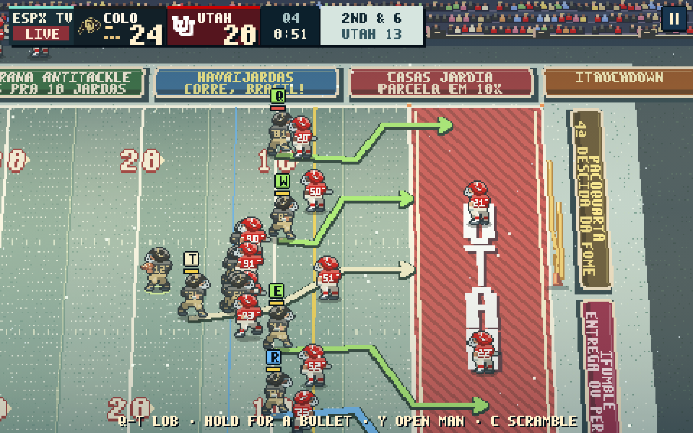
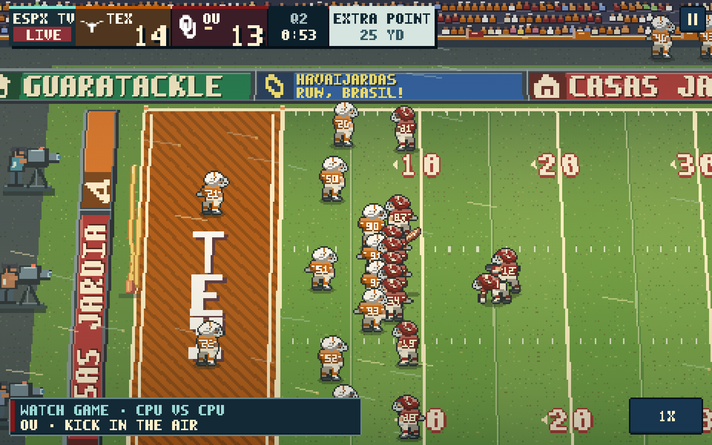
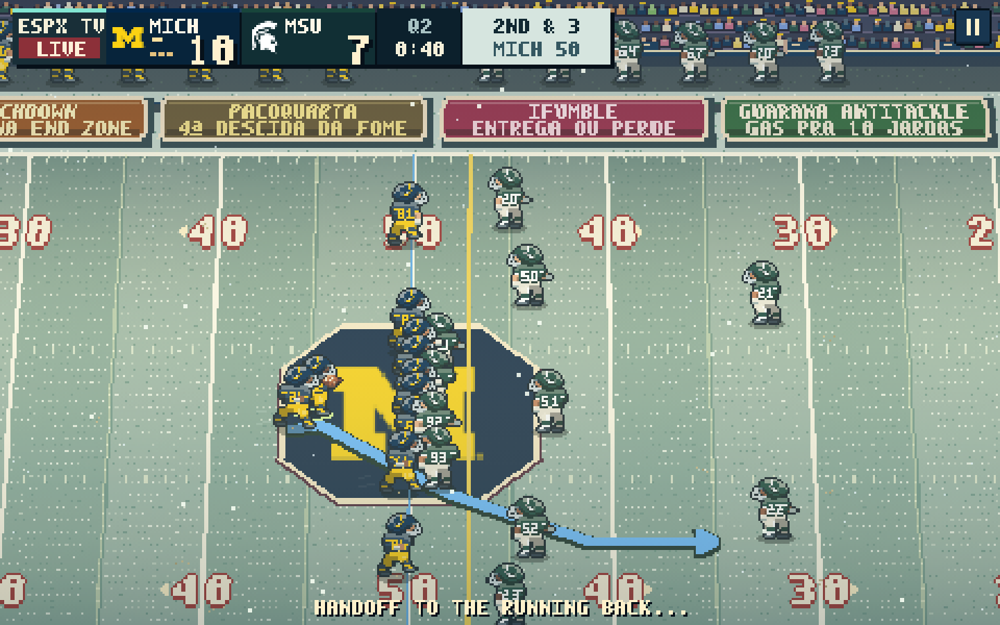
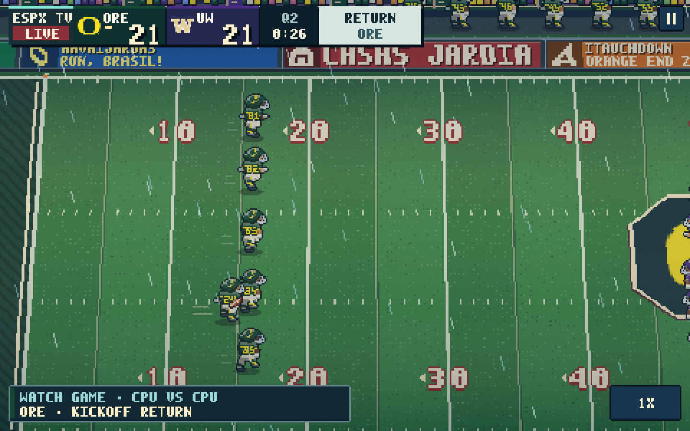
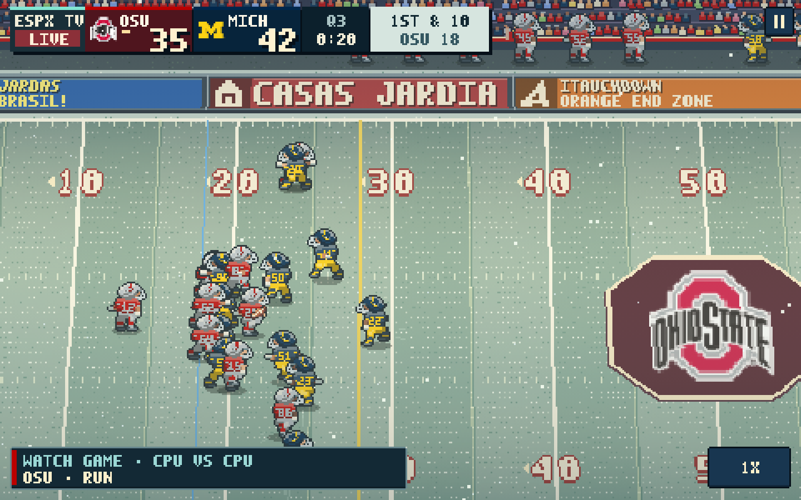

# PIXEL COLLEGE DELUXE

**English** · [Português (Brasil)](README.pt-BR.md)

Pixel-art college football with quick matches, championships, and a coaching career. Pick from 138 FBS programs, read the defense before the snap, and see big plays get the **ESPX TV** treatment.

[Play online](https://felipeaguiarcode.github.io/pixel-college-deluxe/) · [Game modes](#game-modes) · [Controls](#controls) · [Saved progress](#saved-progress)

## 🏈 Your first game

**1.** [Play online](https://felipeaguiarcode.github.io/pixel-college-deluxe/) or open [`index.html`](index.html) offline. If you received a ZIP, extract the whole folder first and keep `assets/` next to the file.

**2.** The game opens in English. To switch the in-game menus, go to **Settings → Language → Português (Brasil)**.

**3.** Open **Quick Play**. Pick your team on the left and the opponent on the right. Each side has its own dice button for a random pick.

**4.** Choose **Rookie**, **College**, or **All-star**, and set quarters to **1, 2, or 3 minutes**. Weather defaults to **Random**. To learn the controls, try **Rookie**, one-minute quarters, and **Clear** weather.

**5.** Select **Play**. Press **Space** or tap the screen to skip the ESPX TV intro.

## 📸 Screenshots

<table>
  <tr>
    <td></td>
    <td></td>
  </tr>
  <tr>
    <td></td>
    <td></td>
  </tr>
  <tr>
    <td></td>
    <td></td>
  </tr>
</table>

## 🏆 Game modes

| Mode | How it works |
| :---: | :---: |
| **Quick Play** | Pick both teams and set the game conditions. Use it to practice, try a playbook, or play a rivalry. |
| **Watch Game** | Pick two teams and watch the CPU play a full game on ESPX TV. Choose the weather and quarter length, then switch between **1×**, **2×**, and **4×** with **V** or the on-screen speed button. |
| **Championship** | Choose the national NCAA FBS field or a conference. Each win earns **3 standings points**. Point differential and points scored break ties. Up to **12 teams nationally** or **8 from a conference field** reach the bracket. Play your matchup or simulate the round. |
| **Challenge** | Pick Army, Navy, Air Force, Coast Guard, or Merchant Marine. Each academy has four comeback scenarios with set scores, clocks, and weather. Win a scenario to earn its trophy. The academy cards track your progress. |
| **Career** | Take over a program, manage the roster, and coach through multiple seasons. The Career Hub tracks your next game, ranking, goals, and athletic director confidence. |
| **Team Editor** | Customize a school's name, abbreviation, mascot, colors, helmet, and strength. With an active career, you can also edit your players' names, numbers, and positions. |

### 📋 Coaching career

**Schedule and postseason.** Play a 12-game regular season. The top two teams in each conference play for its title. Twelve teams make the national playoff, with first-round byes for the top four. Six or more wins can earn a bowl berth if you miss the playoff. Open **League** for the schedule and Top 25.

**Goals and confidence.** Each season has three goals. Completing them earns coaching credits (**CC**), scholarship funds, and athletic director confidence. Simulated games count. At zero confidence, the athletic director fires the coach.

**Roster and recruiting.** Use scholarship funds to recruit and manage up to 12 players. Keep an eye on condition, injuries, and grades. Players with a **GPA below 2.0** are ineligible.

**Facilities and practice.** Spend CC on the stadium, training center, and recovery center. Harder practices earn more experience and increase fatigue.

**Legacy.** Look back at past seasons, championships, and the players who came through your program.

## 🎮 Controls

### ⌨️ Keyboard and mouse

| Situation | Input |
| :---: | :---: |
| Call a play | Use **← / →** to browse, **↑ / ↓** to switch offensive tabs, and **Enter** to confirm. The numbers on the cards are shortcuts. |
| Before the snap | Press **Space** to snap. Press **Q** to return to the playbook. |
| Pass from the pocket | **Q / W / E / R / T** select the receivers marked on the field. **Y** selects the most open target. Tap and release for a lob or hold and release for a bullet pass. |
| Throw a quick bullet pass | Press **Space** while the quarterback is ready to throw to target the most open receiver. |
| Place a pass | Click and drag to aim, then release. Hold **Shift** when you release for a harder throw. |
| Run and dodge | Press **C** to scramble with the QB. As the runner, use **W / S** or **↑ / ↓** to dodge and **Shift** to sprint. On a designed run, the QB hands the ball off automatically. |
| Dive with the ball | Press **E** or **Space** while running. With the QB ready to throw, **E** selects a receiver. |
| Kick or hit a timing meter | Press **Space** when the marker reaches the green zone. |
| Receive a kickoff | Press **1** to call a fair catch or **2** to try a return. |
| Call a timeout | Press **T** between plays when you have a timeout left. With the QB ready to throw, **T** targets the running back. |
| Pause or advance | Press **Esc** or **P** to pause. Press **Space** to advance after a play or skip a cutscene. |

Use the **arrow keys** to move the QB in the pocket. The letter keys select passing targets in that situation.

### 📱 Touch controls

Play in landscape for a wider view. Tap a play card to select it, then tap the field to snap.

Tap a receiver for a lob. Hold and release for a bullet pass. Drag to place a pass.

While running, drag up or down or use **▲ / ▼**. Tap **Dive** to reach for the last few yards.

Tap the buttons shown in a QTE sequence. For kicks and timing meters, tap at the right moment.

Use the pause button next to the scoreboard. Tap the screen to skip the intro or a highlight.

## 🎯 Playing better

### 🥅 Downs, scoring, and kicks

You have **four downs to gain ten yards** and earn a new set of downs. On fourth down, go for it, try a field goal if you're in range, or punt. A tie at the end of regulation goes to overtime.

| Scoring play | Points |
| :---: | :---: |
| Touchdown | 6 |
| Extra point after a touchdown | 1 |
| Two-point conversion after a touchdown | 2 |
| Field goal | 3 |
| Safety | 2 for the defense |

After a touchdown, choose an extra point or a two-point play. Longer kicks require more precision, so check where the green zone sits before you press. In regulation, a conversion attempt or made field goal is followed by a kickoff. As the receiving team, try a return to gain field position or call a fair catch to end the play. A **touchback** puts the ball on the receiving team's 25-yard line.

### ❄️ Offense, coverage, and weather

Read the routes before the snap and use the meter under each receiver's marker to find space. The AI varies its alignment and coverage depth based on the down, distance, and field position.

Use short throws or crossing routes against quick pressure. Save the deep ball for when the pocket holds and the receiver has room.

**Rain** and **thunderstorms** make passes less accurate and the ball harder to catch. **Snow** reduces passing range and makes changes of direction slower. **Strong wind** moves passes and kicks sideways. **Fog** reduces visibility on the field.

### ⚡ QTEs and one-handed catches

Quick-time events appear in the center of the field. For sequences, press the arrows and letters from left to right before time runs out. Correct inputs dim the buttons and briefly shake the field. Wrong inputs leave an **X**.

An open receiver gets a larger green timing window. Tight coverage shrinks the window and can move it along the meter. Hit the green to make the catch. When a **gold** segment appears, hit it for a one-handed catch on a completed pass.

One-handed catches, interceptions, conversions, and other big plays can trigger a full-width highlight. Press **Space** or tap the screen to continue.

On a **two-point conversion**, the green catch window is smaller and reaching the end zone starts a sequence of 8–10 inputs. Finish the sequence to earn the two points.

### 🛡️ Defensive calls

| Call | When to use it |
| :---: | :---: |
| **Blitz** | Bring pressure off the edges and go for a sack. |
| **Man to Man** | Match defenders to individual receivers. |
| **Deep Zone** | Protect against deep throws when the opponent needs a lot of yards. |
| **Cover 2** | Split deep coverage between two safeties and cover the flats. |
| **Nickel** | Use five defensive backs against the slot and short routes. |
| **Goal Line** | Close off the middle near the end zone or against a short run. |

In a **pass-defense QTE**, **100%** accuracy earns an interception. At **80% or higher**, you tackle the receiver after the catch. Below **80%**, the receiver gets away.

## 💾 Saved progress

Career and Championship progress stay in your browser. Use the same browser and profile to continue, and play in a regular window to keep your progress. Quick Play results are for that match.

Back up your career from **Settings → Export Save**. Restore it with **Settings → Import Save**. Importing a save or starting a new career replaces the active career after confirmation. Export your progress before switching browsers, moving the files, or clearing site data.

## 🛟 Quick help

| Situation | What to do |
| :---: | :---: |
| The game paused when you switched tabs | Return to the game and select **Continue**. |
| Sound is muted when you open the game | Click or tap the game and check sound effects and menu music in **Settings**. |
| Field art is missing | Extract the whole folder and check that `assets/` sits next to `index.html`. |
| You need to leave before the end | Choose **Simulate rest** from the pause menu to finish the game. Leaving a Career or Championship match counts as a loss. |

[Visual credits](assets/docs/art-credits.md)

