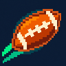
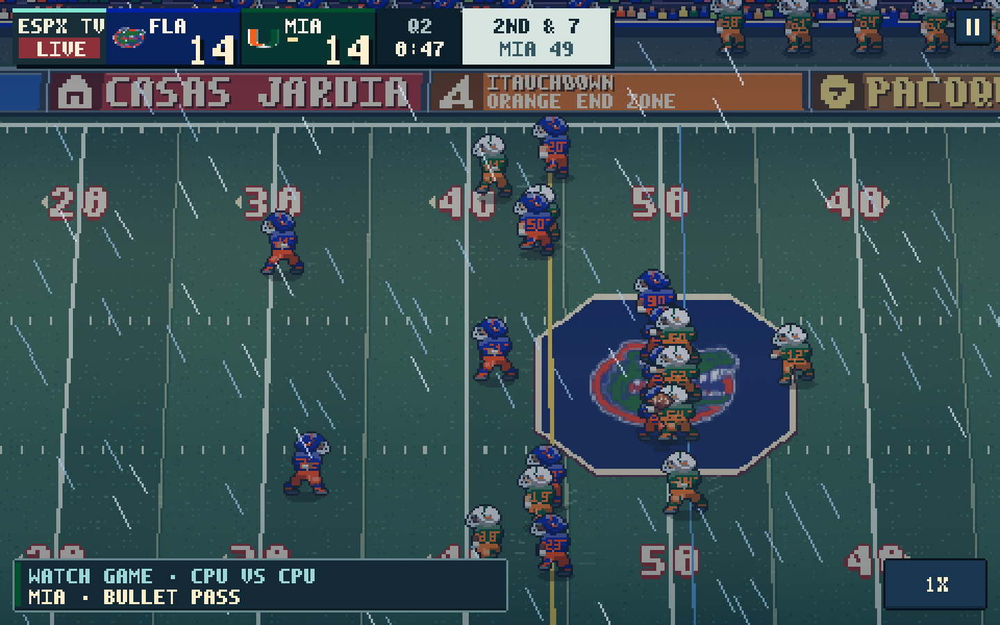
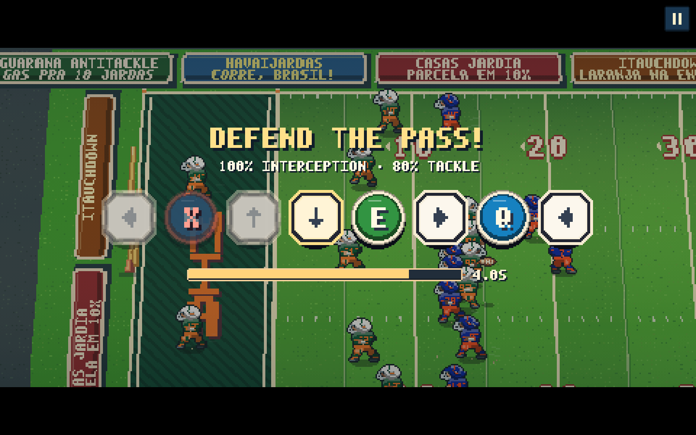

# PIXEL COLLEGE DELUXE

**English** · [Português (Brasil)](README.pt-BR.md)

Pixel-art college football with quick matches, championships, and a coaching career. Pick from 138 FBS programs, read the defense before the snap, and see big plays get the **ESPX TV** treatment.

[Play online](https://felipeaguiarcode.github.io/pixel-college-deluxe/) · [Game modes](#game-modes) · [Controls](#controls) · [Saved progress](#saved-progress)

## 🏈 Your first game

**1.** [Play online](https://felipeaguiarcode.github.io/pixel-college-deluxe/) or open [`index.html`](index.html) offline. If you received a ZIP, extract the whole folder first and keep `assets/` and `.store/` next to the file.

**2.** The game opens in English. To switch the in-game menus, go to **Settings → Language → Português (Brasil)**.

**3.** Open **Quick Play**. Pick your team on the left and the opponent on the right. Each side has its own dice button for a random pick.

**4.** Choose **Rookie**, **College**, or **All-star**, and set quarters to **1, 2, or 3 minutes**. Weather defaults to **Random**. To learn the controls, try **Rookie**, one-minute quarters, and **Clear** weather.

**5.** Select **Play**. Press **Space** or tap the screen to skip the ESPX TV intro.

## 📸 Screenshots

<table>
  <tr>
    <td></td>
    <td></td>
  </tr>
  <tr>
    <td></td>
    <td></td>
  </tr>
  <tr>
    <td></td>
    <td></td>
  </tr>
</table>

## 🏆 Game modes

| Mode | How it works |
| :---: | :---: |
| **Quick Play** | Pick both teams and set the game conditions. Use it to practice, try a playbook, or play a rivalry. |
| **Watch Game** | Pick two teams and watch the CPU play a full game on ESPX TV. Choose the weather and quarter length, then switch between **1×**, **2×**, and **4×** with **V** or the on-screen speed button. |
| **Championship** | Choose the national NCAA FBS field or a conference. Each win earns **3 standings points**. Point differential and points scored break ties. Up to **12 teams nationally** or **8 from a conference field** reach the bracket. Play your matchup or simulate the round. |
| **Challenge** | Pick Army, Navy, Air Force, Coast Guard, or Merchant Marine. Each academy has four comeback scenarios with set scores, clocks, and weather. Win a scenario to earn its trophy. The academy cards track your progress. |
| **Career** | Take over a program, manage the roster, and coach through multiple seasons. The Career Hub tracks your next game, ranking, goals, and athletic director confidence. |
| **Team Editor** | Customize a school's name, abbreviation, mascot, colors, helmet, and strength. With an active career, you can also edit your players' names, numbers, and positions. |

### 📋 Coaching career

**Schedule and postseason.** Play a 12-game regular season. The top two teams in each conference play for its title. Twelve teams make the national playoff, with first-round byes for the top four. Six or more wins can earn a bowl berth if you miss the playoff. Open **League** for the schedule and Top 25.

**Goals and confidence.** Each season has three goals. Completing them earns coaching credits (**CC**), scholarship funds, and athletic director confidence. Simulated games count. At zero confidence, the athletic director fires the coach.

**Roster and recruiting.** Use scholarship funds to recruit and manage up to 12 players. Keep an eye on condition, injuries, and grades. Players with a **GPA below 2.0** are ineligible.

**Facilities and practice.** Spend CC on the stadium, training center, and recovery center. Harder practices earn more experience and increase fatigue.

**Legacy.** Look back at past seasons, championships, and the players who came through your program.

## 🎮 Controls

### ⌨️ Keyboard and mouse

| Situation | Input |
| :---: | :---: |
| Call a play | Use **← / →** to browse, **↑ / ↓** to switch offensive tabs, and **Enter** to confirm. The numbers on the cards are shortcuts. |
| Before the snap | Press **Space** to snap. Press **Q** to return to the playbook. |
| Pass from the pocket | **Q / W / E / R / T** target the marked receivers. **Y** or **Space** target the most open receiver. Tap for a **Lob**, hold briefly for **Touch**, or hold longer for **Bullet**. |
| Throw high or low | Hold **Shift** while pressing the pass button for **High**. Hold **Shift + ↓** while pressing it for **Low**. |
| Place a pass | Click and drag to aim, then release for a **Touch** pass. The High and Low modifiers also work on release. |
| Move with the ball | Press **C** to scramble with the QB. Use **WASD** or the **arrow keys** to run in any direction, and hold **Shift** to sprint. Release the direction to slow to a stop. On a designed run, the QB hands the ball off automatically. |
| Dive with the ball | Press **E** or **Space** while running. With the QB ready to throw, **E** selects a receiver. |
| Kick or hit a timing meter | Press **Space** when the marker reaches the green zone. |
| Receive a kickoff | Press **1** to call a fair catch or **2** to try a return. |
| Call a timeout | Press **T** between plays when you have a timeout left. With the QB ready to throw, **T** targets the running back. |
| Pause or advance | Press **Esc** or **P** to pause. Press **Space** to advance after a play or skip a cutscene. |

Use the **arrow keys** to move the QB in the pocket. The letter keys select passing targets in that situation.

### 📱 Touch controls

Play in landscape for a wider view. Tap a play card to select it, then tap the field to snap.

Tap a receiver for a **Lob**, hold briefly for **Touch**, or hold longer for **Bullet**. Hold **Sprint** and tap a receiver for **High**. For **Low**, slide down from **Sprint** and keep holding while tapping the receiver. Drag to place a pass.

Use the on-screen joystick to move in the pocket or run with the ball. While running, you can also drag anywhere on the field in any direction. Hold **Sprint** to run faster. Tap **Dive** to lunge in the direction you're moving.

Tap the buttons shown in a QTE sequence. For kicks and timing meters, tap at the right moment.

Use the pause button next to the scoreboard. Tap the screen to skip the intro or a highlight.

## 🎯 Playing better

### 🥅 Downs, scoring, and kicks

You have **four downs to gain ten yards** and earn a new set of downs. On fourth down, go for it, try a field goal if you're in range, or punt. A tie at the end of regulation goes to overtime.

| Scoring play | Points |
| :---: | :---: |
| Touchdown | 6 |
| Extra point after a touchdown | 1 |
| Two-point conversion after a touchdown | 2 |
| Field goal | 3 |
| Safety | 2 for the defense |

After a touchdown, choose an extra point or a two-point play. Longer kicks require more precision, so check where the green zone sits before you press. In regulation, a conversion attempt or made field goal is followed by a kickoff. As the receiving team, try a return to gain field position or call a fair catch to end the play. A **touchback** puts the ball on the receiving team's 25-yard line.

### ❄️ Offense, coverage, and weather

Each school has its own playbook and a **Signature** pass. The diagrams show the same alignments and routes used on the field. Look for the signature play in the Suggested and Pass tabs.

Read the routes before the snap and use the meter under each receiver's marker to find space. Man defenders track receivers through cuts. Zone defenders react to routes entering their area and protect against deeper options. After the throw, the best-positioned defender breaks toward the ball while the rest keep their assignments.

Use short throws or crossing routes against quick pressure. Save the deep ball for when the pocket holds and the receiver has room.

**Rain** and **thunderstorms** make passes less accurate and the ball harder to catch. **Snow** reduces passing range and makes changes of direction slower. **Strong wind** moves passes and kicks sideways. **Fog** reduces visibility on the field.

In **Quick Game** or **Watch Game**, choose conditions such as Rainy Night, Golden Hour, Golden Hour with Light Drizzle, Fog, or Ice Flurries. Reflectors cast a soft glow through fog, and ice flakes brighten as they pass through pools of light. Night thunderstorms add lightning and thunder. Dives follow the runner's momentum at takeoff and slide farther on slick turf.

### ⚡ QTEs and one-handed catches

For quick-time sequences in the center of the field, press the arrows and letters from left to right before time runs out. Correct inputs dim the buttons and briefly shake the field. Wrong inputs leave an **X**.

Longer passes place the catch timing window later on the meter. Tight coverage, defenders in the passing lane, and pressure on the quarterback narrow the green and gold windows. Hit green to make the catch or gold for a one-handed catch.

One-handed catches, interceptions, conversions, and other big plays can trigger a full-width highlight. Press **Space** or tap the screen to continue.

On a **two-point pass**, the green catch window is smaller. Reaching the end zone starts a sequence of 8–10 inputs. Complete it to score. On a run, crossing the goal line with the ball earns two points.

### 🏃 Running QTEs

- **Run boost.** On a called run, a timing bar appears above the running back after the handoff. Press **Shift** or tap the bar to stop the pointer. **Red** drops the ball for either team to recover. **Yellow** ends the run with the ball secured. **Dark green** sends the runner into the best available lane before returning control to you. Hit the **light-green center** for extra speed and an afterimage trail. Letting time run out counts as red.
- **Juke and spin.** In open space, follow two or three arrows in order with **← / ↑ / ↓ / →** or the on-screen arrows. The juke plants a foot and cuts across the field with afterimages, while the spin takes the runner through a full turn. Press **Space** or tap on yellow for extra speed and a stronger trail. Missing the arrows makes the runner stumble and increases the fumble risk on a hard tackle.
- **Contact.** For a **stiff arm**, press the displayed **Q** or **E**, or tap the button at the center of the screen, when the rings meet. Early and late presses change the hit and the ball spot. To **truck** or **protect the ball**, press the displayed key when it lights up. In a **pile**, press the displayed key repeatedly to drag two defenders for up to two yards.

Jukes and spins appear on designed runs, scrambles, and kickoff returns. At contact on a return, press the displayed **Q** or **E** repeatedly or tap to fill the meter above the returner and gain up to three extra yards. If the meter stays empty, the tackle ends the play at the spot of contact.

### 🛡️ Defensive calls

| Call | When to use it |
| :---: | :---: |
| **Blitz** | Bring pressure off the edges and go for a sack. |
| **Man to Man** | Match defenders to individual receivers. |
| **Deep Zone** | Protect against deep throws when the opponent needs a lot of yards. |
| **Cover 2** | Split deep coverage between two safeties and cover the flats. |
| **Nickel** | Use five defensive backs against the slot and short routes. |
| **Goal Line** | Close off the middle near the end zone or against a short run. |

On defense, use **WASD** or the **arrow keys** to move the highlighted defender. **Q / E** switch players, and **Space** attempts a tackle. To try an interception, get in the passing lane and press **Space** when the ball is within reach.

A contested manual tackle can start a **Dynamic Tackle Battle**. Hold **Space** to apply force and use **↑ / ↓** to change stance. Watch both players' stamina and stability. Use a conservative stance to brace for a surge and an aggressive stance to exploit an opening. When a timing prompt shows **Q** or **E**, press that key or tap it when the ring lights up. Clean tackles and tackles by teammates resolve immediately.

The opposing offense mixes inside runs, sweeps, and counters with quick passes, crossing routes, and deep throws. Winning a tackle against a runner triggers a **Run Stop** highlight. Touchdown highlights use the name and colors of the team that scored.

The runner can gain extra yards during a struggle. An open window can lead to a perfect tackle or a strip attempt. A forced fumble leaves the ball live for either team. A defensive lineman can also use a battle to break free of a blocker.

A turnover on downs preserves the spot where the play ended. A missed field goal gives the defense the ball at the spot of the kick.

### 🖥️ Video settings

Open **Video Settings** from the main menu or the pause menu. The defaults are **Broadcast TV**, **CRT · SNES** scanlines, 20% chromatic aberration, 100% CRT fisheye, and 115% screen zoom. Choose **None** or select a CRT profile such as **PS2 · Warm**, **Vivid Colors**, or Mega Drive RGB or Composite. Scanline styles include Fine, SNES, GBA, and Interlaced. CRT fisheye ranges from 0% to 200%, and chromatic aberration ranges from 0% to 100%. Screen zoom enlarges the picture to reduce the black borders around the curved screen while the scoreboard and on-screen text stay sharp. Changes apply immediately and save automatically. Press **Enter** or tap **Press Start**. Use the music button to hear the opening theme before continuing.

## 💾 Saved progress

Career and Championship progress stay in your browser. Use the same browser and profile to continue, and play in a regular window to keep your progress. Quick Play results are for that match.

Back up your career from **Settings → Export Save**. Restore it with **Settings → Import Save**. Importing a save or starting a new career replaces the active career after confirmation. Export your progress before switching browsers, moving the files, or clearing site data.

## 🛟 Quick help

| Situation | What to do |
| :---: | :---: |
| The game paused when you switched tabs | Return to the game and select **Continue**. |
| Sound is muted when you open the game | Click or tap the game and check sound effects and menu music in **Settings**. |
| Field art is missing | Extract the whole folder and check that `assets/` sits next to `index.html`. |
| You need to leave before the end | Choose **Simulate rest** from the pause menu to finish the game. Leaving a Career or Championship match counts as a loss. |

[Visual credits](assets/docs/art-credits.md)

