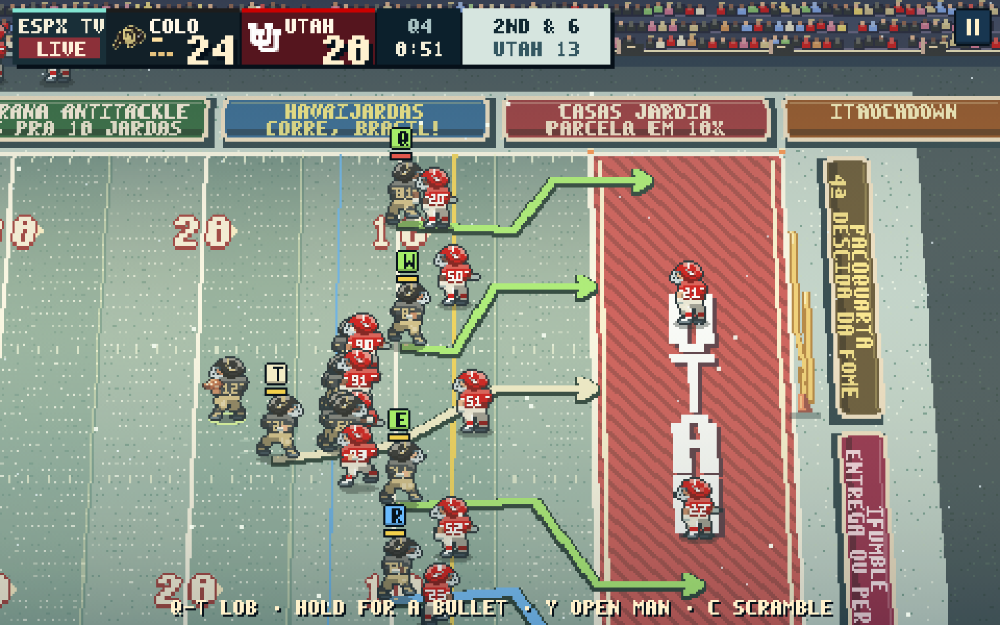

# PIXEL COLLEGE DELUXE

[English](README.md) · **Português (Brasil)**

Futebol americano universitário em pixel art, com partidas rápidas, campeonatos e uma carreira de treinador. Escolha entre 138 programas da FBS, leia a defesa antes do snap e transforme os grandes lances em destaques da **ESPX TV**.

[Jogar online](https://felipeaguiarcode.github.io/pixel-college-deluxe/) · [Modos de jogo](#modos-de-jogo) · [Controles](#controles) · [Salvamento](#salvamento)

## 🏈 Sua primeira partida

**1.** [Jogue online](https://felipeaguiarcode.github.io/pixel-college-deluxe/) ou abra [`index.html`](index.html) para jogar offline. Se recebeu o jogo compactado, extraia tudo primeiro e mantenha `assets/` ao lado do arquivo.

**2.** O menu começa em inglês. Para trocar, abra **Settings → Language → Português (Brasil)**.

**3.** Entre em **Quick Play / Jogo Rápido**. Escolha seu time à esquerda e o rival à direita. O dado de cada lado sorteia aquele time.

**4.** Escolha a dificuldade (**Rookie**, **College** ou **All-star**) e quartos de **1, 2 ou 3 minutos**. O clima começa em **Aleatório**. Para aprender os controles, experimente **Rookie**, um minuto por quarto e **Tempo limpo**.

**5.** Selecione **Play / Jogar**. Pule a abertura da ESPX TV com **Espaço** ou um toque na tela.

## 🏆 Modos de jogo

| Modo | Como funciona |
| :---: | :---: |
| **Quick Play / Jogo Rápido** | Escolha os dois times e as condições da partida. Use para praticar, testar um playbook ou jogar uma rivalidade. |
| **Watch Game / Assistir Partida** | Escolha dois times e assista a IA jogar uma partida inteira na ESPX TV. Defina o clima e a duração dos quartos. Alterne entre **1×**, **2×** e **4×** com **V** ou pelo botão na tela. |
| **Championship / Campeonato** | Escolha a NCAA FBS nacional ou uma conferência e dispute a fase de classificação. Cada vitória vale **3 pontos** na tabela. O saldo e os pontos marcados servem de desempate. Avançam até **12 times no nacional** e até **8 por conferência**. Acompanhe o chaveamento, jogue sua partida ou simule a rodada. |
| **Challenge** | Escolha Army, Navy, Air Force, Coast Guard ou Merchant Marine. Cada academia tem quatro cenários de virada com placar, relógio e clima definidos. Vença para conquistar o troféu da partida e acompanhar o progresso no card da academia. |
| **Career / Carreira** | Assuma um programa, gerencie o elenco e dispute temporadas. A Central da Carreira mostra o próximo jogo, o ranking, as metas e a confiança da diretoria. |
| **Team Editor / Editor de Times** | Personalize nome, sigla, mascote, cores, capacete e força de uma universidade. Com uma carreira ativa, você também pode editar os nomes, números e posições do próprio elenco. |

### 📋 Carreira de treinador

**Calendário e pós-temporada.** São 12 jogos na temporada regular. Os dois primeiros de cada conferência disputam a final. O playoff nacional reúne 12 equipes, com folga para as quatro primeiras na rodada inicial. Uma campanha de seis ou mais vitórias pode render um bowl se o time ficar fora do playoff. Acompanhe o calendário e o Top 25 em **Liga**.

**Metas e confiança.** Cada temporada tem três metas. Cumpri-las rende créditos de treinador (**CC**), bolsas e confiança da diretoria. Os jogos simulados também contam. Com a confiança em zero, o treinador é demitido.

**Elenco e recrutamento.** Use o fundo de bolsas para recrutar atletas e cuidar de um elenco de até 12 jogadores. Fique de olho na condição física, nas lesões e nas notas. Média acadêmica (**GPA**) abaixo de 2,0 suspende o atleta.

**Estrutura e treino.** Invista CC no estádio, no centro de treino e na recuperação. Treinos mais intensos rendem mais experiência e aumentam a fadiga.

**Legado.** Consulte suas campanhas anteriores, títulos e os atletas que passaram pelo programa.

## 🎮 Controles

### ⌨️ Teclado e mouse

| Situação | Comando |
| :---: | :---: |
| Escolher a jogada | **← / →** para navegar, **↑ / ↓** para mudar a aba de ataque e **Enter** para confirmar. Os números dos cartões são atalhos. |
| Antes do snap | **Espaço** inicia o lance. **Q** volta ao playbook. |
| Passar com o QB no pocket | **Q / W / E / R / T** selecionam os alvos indicados no campo. **Y** escolhe o mais livre. Pressione e solte rápido para um passe alto. Segure e solte para um passe forte. |
| Passe forte para o mais livre | **Espaço** com o QB pronto para lançar. |
| Passe colocado | Clique, arraste a mira no campo e solte. Segure **Shift** ao soltar para lançar mais forte. |
| Correr e desviar | **C** faz o QB sair do pocket correndo. Com a bola em corrida, use **W / S** ou **↑ / ↓** para desviar e **Shift** para acelerar. O QB entrega a bola ao RB automaticamente em jogadas de corrida. |
| Mergulhar com a bola | **E** ou **Espaço** durante a corrida. Com o QB pronto para passar, **E** seleciona um recebedor. |
| Chutar ou acertar uma barra de precisão | **Espaço** quando o marcador chegar à faixa verde. |
| Receber um kickoff | **1** para pedir fair catch ou **2** para tentar o retorno. |
| Pedir tempo | **T** com a bola parada e tempo disponível. Com o QB pronto para passar, **T** seleciona o RB. |
| Pausar ou avançar | **Esc** ou **P** pausa. **Espaço** avança depois do fim da jogada e pula as cenas cinematográficas. |

Enquanto o QB está no pocket, use as **setas** para se mover. As letras de passe ficam reservadas para os alvos nessa situação.

### 📱 Celular ou tela sensível ao toque

Prefira jogar na horizontal. Toque no cartão para escolher a jogada e no campo para o snap.

Toque no recebedor para um passe alto. Segure e solte para um passe forte. Arraste a mira para um passe colocado.

Na corrida, arraste para cima ou para baixo ou use os botões **▲ / ▼**. Toque em **Mergulhar** para ganhar as últimas jardas.

Toque nos próprios botões da sequência de QTE. Nos chutes e nas barras de precisão, toque no momento certo.

Use o botão de pausa no placar. Um toque na tela pula a abertura ou uma cena de destaque.

## 🎯 Como jogar melhor

### 🥅 Descidas, pontos e chutes

Você tem **quatro descidas para avançar dez jardas** e conquistar uma nova série. Na quarta, você pode arriscar a conversão, tentar um field goal se estiver ao alcance ou devolver a bola com um punt. Se o jogo terminar empatado, vai para a prorrogação.

| Lance | Pontos |
| :---: | :---: |
| Touchdown | 6 |
| Extra point após o touchdown | 1 |
| Conversão em jogada após o touchdown | 2 |
| Field goal | 3 |
| Safety | 2 para a defesa |

Depois do touchdown, escolha o chute extra ou uma jogada de dois pontos. Chutes longos pedem mais precisão, então observe a posição da faixa verde antes de apertar. No tempo regulamentar, a conversão ou o field goal convertido é seguido pelo kickoff. Quando estiver recebendo, escolha o retorno para tentar ganhar campo ou o fair catch para encerrar a jogada. Um **touchback** coloca a equipe que recebe na própria linha de 25 jardas.

### ❄️ Ataque, leitura de campo e clima

Olhe as rotas antes do snap e a barra sob o indicador do recebedor para encontrar quem tem espaço. A IA muda o alinhamento e a profundidade da cobertura conforme a descida, a distância e a posição no campo.

Contra pressão rápida, procure um passe curto ou uma rota cruzada. Guarde os passes mais longos para quando houver tempo no pocket e espaço para o alvo.

Na **chuva** e no **temporal**, os passes perdem precisão e a bola fica mais difícil de segurar. Na **neve**, o alcance diminui e mudar de direção leva mais tempo. O **vento forte** desvia passes e chutes. A **névoa** reduz a visibilidade no campo.

### ⚡ QTEs e recepção com uma mão

Os QTEs são desafios rápidos que aparecem no centro da tela. Em uma sequência, siga as setas e letras da esquerda para a direita antes que o tempo acabe. Os acertos escurecem o botão e dão um leve tremor no campo. Os erros ficam marcados com **X**.

Na barra de recepção, jogadores livres ganham uma área verde maior. Sob pressão, a faixa fica menor e pode aparecer em outra posição. Acerte a faixa verde para completar a recepção. Quando houver um segmento **dourado**, acertá-lo ativa a recepção com uma mão se o passe for completado.

Recepções com uma mão, interceptações, conversões e outros lances grandes podem abrir uma faixa animada de ponta a ponta. Use **Espaço** ou toque na tela para seguir.

Na **conversão de dois pontos**, a janela verde de recepção é menor e chegar à end zone inicia uma sequência de 8 a 10 comandos. Complete a sequência para garantir os dois pontos.

### 🛡️ Escolha defensiva

| Chamada | Quando experimentar |
| :---: | :---: |
| **Blitz** | Para pressionar o QB pelas pontas e buscar um sack. |
| **Homem a Homem / Man to Man** | Para acompanhar os recebedores individualmente. |
| **Zona Profunda / Deep Zone** | Quando o adversário precisa de muitas jardas e a prioridade é proteger o fundo. |
| **Cobertura 2 / Cover 2** | Para dividir a cobertura profunda entre dois safeties e proteger as laterais. |
| **Nickel** | Contra o slot e as rotas curtas, com cinco defensive backs. |
| **Linha do Gol / Goal Line** | Perto da end zone ou contra uma corrida curta pelo meio. |

No QTE de **defesa do passe**, **100%** de acerto dá a interceptação. Com **80% ou mais**, você derruba o recebedor depois da recepção. Abaixo de **80%**, o recebedor escapa.

## 💾 Salvamento

Carreira e campeonato ficam no armazenamento do navegador. Use o mesmo navegador e perfil para continuar e evite jogar em janela privada se quiser manter o progresso. Resultados de Jogo Rápido valem para aquela partida.

Para guardar uma cópia da carreira, vá a **Opções → Exportar save**. Para carregar o arquivo, abra **Opções → Importar save**. A importação e o início de uma nova carreira substituem a carreira ativa após a confirmação. Exporte seu progresso antes de trocar de navegador, mover os arquivos ou limpar os dados do site.

## 🛟 Ajuda rápida

| Se acontecer… | O que fazer |
| :---: | :---: |
| A partida pausou ao trocar de aba | Volte ao jogo e selecione **Continuar**. |
| O som ficou mudo ao abrir | Clique ou toque no jogo e confira efeitos sonoros e música em **Opções**. |
| O campo abriu com arte faltando | Abra o `index.html` depois de extrair a pasta inteira e confira se a pasta `assets/` está junto dele. |
| Você precisa sair antes do fim | Na pausa, use **Simular o resto** para concluir a partida. Abandonar uma partida na carreira ou no campeonato conta como derrota. |

[Créditos visuais](assets/docs/art-credits.md)

